<p align="center">
  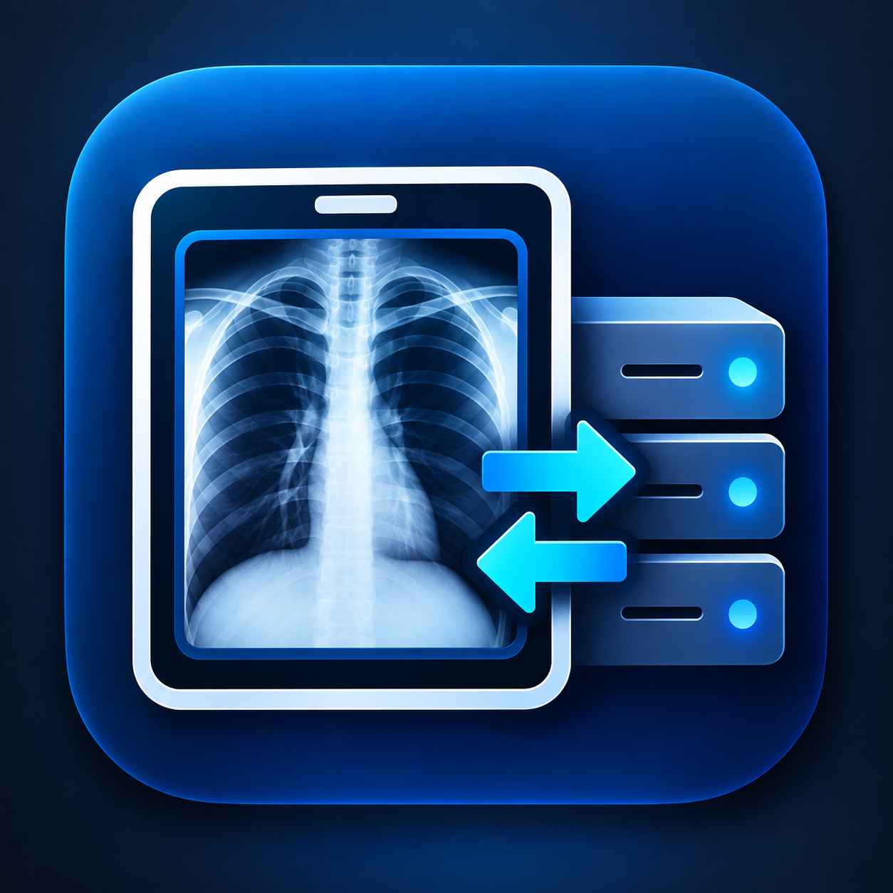
</p>

<h1 align="center">DICOM Kit (Android)</h1>

Текущая версия — **1.6.0-beta.1** (`10600`), GitHub Pre-release. Это предварительный бета-выпуск для проверки, не финальная стабильная версия. Подробности изменений: [CHANGELOG](CHANGELOG.md); проверки и ограничения: [план приёмки](docs/ANDROID_ACCEPTANCE_TEST_PLAN.md). Для обновления устанавливайте штатный подписанный `DICOM-Kit-1.6.0-beta.1-release.apk` поверх прежнего Release без удаления приложения и очистки данных. Изолированные сборки `.storagesafetytest` имеют отдельные данные и основную версию не обновляют.

<p align="center">
  <strong>Профессиональный автономный мобильный инструмент для сервисных инженеров медицинской техники и специалистов PACS</strong>
</p>

<p align="center">
  
  
  
  
  
</p>

---

## О проекте

**DICOM Kit** превращает Android-планшет или смартфон в **полноценный мобильный диагностический DICOM-узел**, способный принимать, передавать, генерировать, визуализировать и исследовать медицинские снимки и рабочие списки непосредственно в госпитальной локальной сети или по Wi-Fi.

### Ключевые преимущества для сервисного инженера:
- **100% автономность и конфиденциальность:** приложение работает строго локально, не требует доступа в интернет, не передаёт аналитику и телеметрию, исключая риск утечки персональных данных пациентов (PHI/HIPAA).
- **Настоящий сетевой стек DICOM:** реализация на базе промышленной библиотеки `dcm4che 5.33.1` (PS3.7 DIMSE, PS3.8 Network Exchange, PS3.10 Media Storage, PS3.4 SOP Classes).
- **Двусторонний обмен (SCP + SCU):** приём снимков с диагностических аппаратов (Storage SCP), отправка на PACS (Storage SCU), а также полный Modality Worklist (MWL SCP и SCU) в одном карманном устройстве.
- **Встроенный генератор тестовых исследований:** проверка тракта передачи без необходимости использовать реальные снимки пациентов.
- **Инженерный просмотрщик:** полноценная регулировка окна яркости/контраста (WW/WL), инверсия, зум и чтение 8/16-битных матриц высокого разрешения.
- **Глубокий технический журнал:** неблокирующая фоновая фиксация всех PDU-сообщений, согласования контекстов представления и кодов ошибок с переводом на понятный русский язык.

---

## Основные разделы приложения

### 1. DICOM Приёмник (Storage SCP)
Фоновая служба `DicomScpForegroundService`, позволяющая медицинским аппаратам и серверам PACS отправлять снимки на Android-устройство по протоколам `C-ECHO` и `C-STORE`.
- Привязка к любому доступному сетевому интерфейсу устройства (`Wi-Fi`, `Ethernet`, `USB Tethering`).
- Настраиваемый порт (по умолчанию `11112`) и Called AE Title (по умолчанию `ANDROID_PACS`).
- Поддержка синтаксисов передачи `Explicit VR Little Endian` (1.2.840.10008.1.2.1) и `Implicit VR Little Endian` (1.2.840.10008.1.2).
- Потоковая запись входящих DICOM-объектов во внутреннее изолированное хранилище с атомарной гарантией целостности (`FileDescriptor.sync()`).
- Совместимость Storage SCP: ведущие нули в цифровых компонентах Study/Series/SOP Instance UID допускаются с предупреждением в подробном журнале с указанием тега. Это отклонение отправителя от [PS3.5 §9.1](https://dicom.nema.org/medical/dicom/current/output/chtml/part05/chapter_9.html), а не нормализация: исходные UID, Dataset и Pixel Data сохраняются.
- Счётчики сеансов, принятых исследований, активных TCP-подключений и список обращавшихся узлов.

<p align="center">
  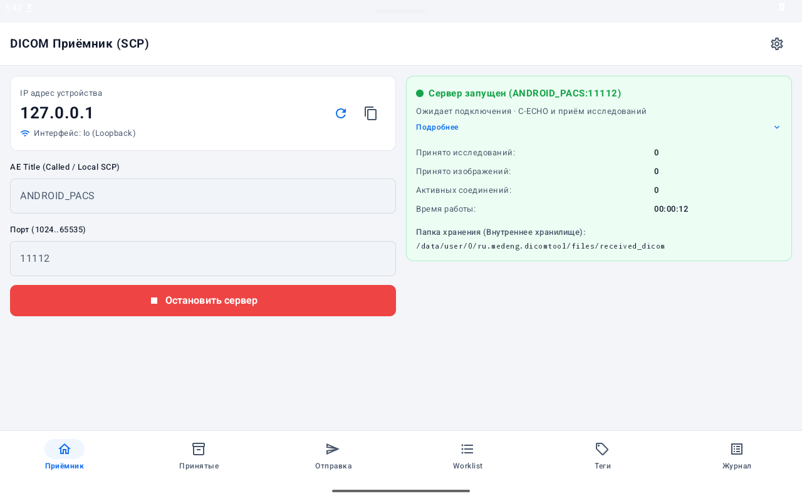
</p>

---

### 2. Принятые исследования (Архив)
Автоматическая каталогизация принятых файлов по стандарту DICOM:
- Иерархическая группировка по **Study Instance UID** и **Series Instance UID**.
- Быстрые фильтры по модальностям (`CT`, `MR`, `DX`, `CR`, `MG`, `US`, `OT`).
- Отображение даты и времени исследования, количества серий/снимков, размера на диске и размера матрицы.
- Быстрое открытие исследования во встроенном DICOM Viewer в одно касание.
- Безопасное удаление отдельных исследований или очистка всего архива.

<p align="center">
  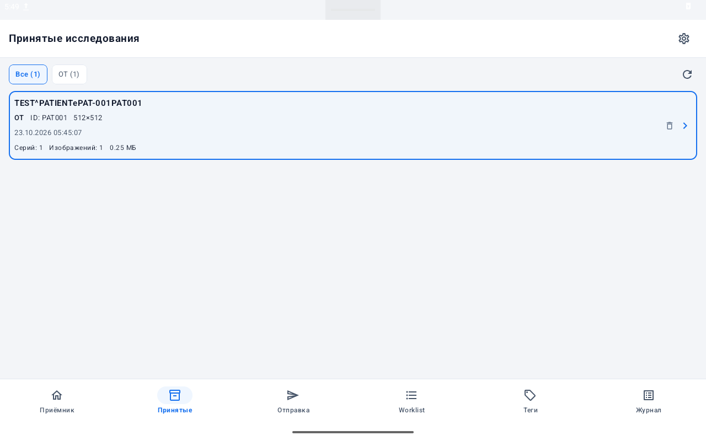
</p>

---

### 3. Инженерный DICOM Viewer
Специализированный просмотрщик медицинских снимков с аппаратным ускорением и мгновенным откликом:
- **Высокоскоростной расчёт окна WW/WL:** 65536-элементная таблица пересчёта (LUT), оптимизированная для изображений высокого разрешения (включая цифровые маммограммы `3580 × 2680`, `18+ МБ`).
- **Поддерживаемые форматы матриц:** `MONOCHROME1`, `MONOCHROME2` (8-бит и 16-бит, знаковый и беззнаковый пиксель), цветные RGB-изображения (`PlanarConfiguration 0/1`).
- **Медицинский конвейер преобразования:** `Modality LUT` (Rescale Slope / Intercept) → `VOI LUT` (Window Center / Width) → `Photometric Interpretation` + ручная инверсия.
- **Интерактивное управление:** ползунки и шаговые кнопки WW/WL, пресеты исходного окна из тегов DICOM и автоподбор Мин/Макс, сброс параметров.
- **Масштабирование:** свободный Pan & Pinch Zoom, шаговые кнопки Zoom+/Zoom-, режим «Fit» (по размеру экрана) и полноэкранный режим (**«Экран»**).
- **Инженерный оверлей:** текущие WW/WL, размер матрицы, глубина цвета, фотометрия, масштаб и номер кадра.

<p align="center">
  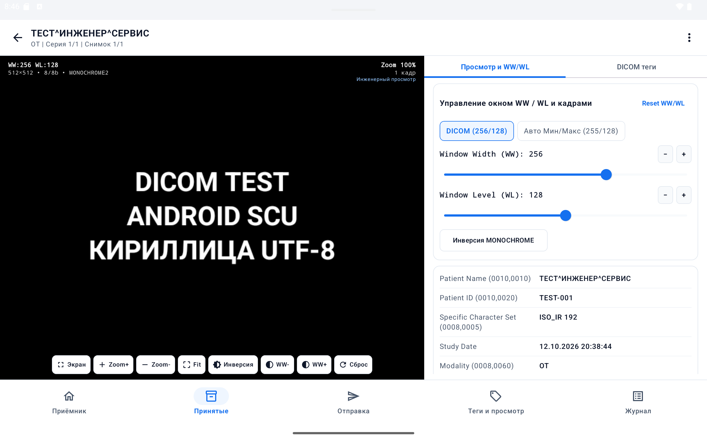
</p>

---

### 4. Отправка DICOM (C-ECHO / C-STORE SCU)
Модуль исходящих DICOM-операций для проверки связи с PACS и отправки данных:
- **Два режима отправки:**
  - **1. Тестовое изображение:** генерация чистого DICOM-объекта `Secondary Capture Image Storage` (1.2.840.10008.5.1.4.1.1.7) с матрицей `512 × 512` 8-bit `MONOCHROME2`.
    - *Режим «Текст»:* многострочный инженерный текст (поддержка кириллицы в UTF-8 `ISO_IR 192` и латиницы).
    - *Режим «Смайлик»:* процедурный генератор графических смайликов с фиксацией зерна генерации.
    - *Режим «Рисунок»:* интерактивный холст для рисования схем или пометок пальцем/стилусом с регулировкой толщины линии.
    - *Карточка пациента:* обязательные поля ФИО и ID пациента; до их заполнения генерация блокируется с понятным предупреждением.
  - **2. DICOM-файлы:** выбор и отправка реальных DICOM-файлов из файловой системы устройства через Storage Access Framework (SAF).
- **Параметры PACS:** IP/хост, порт, Called AE Title, Calling AE Title с автоматическим сохранением между сеансами.
- **Строгая валидация:** перед запуском C-ECHO и C-STORE проверяется корректность каждого параметра с наглядными подсказками на русском языке.

<p align="center">
  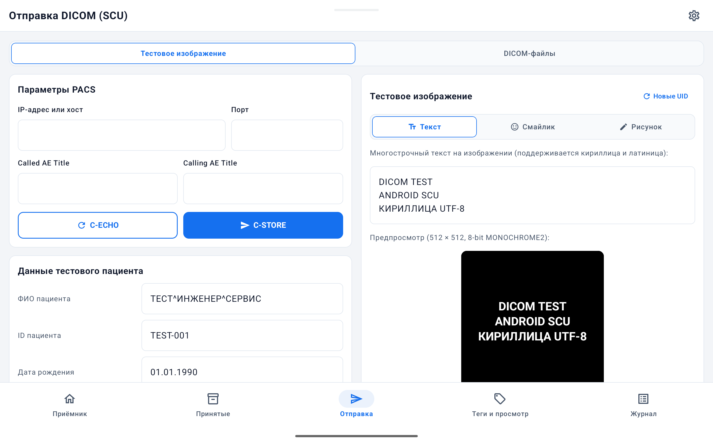
</p>

---

### 5. Инспектор DICOM-тегов (Tags & Viewer)
Инструмент для глубокого анализа заголовков DICOM Part 10:
- Поддержка открытия локальных файлов с устройства через системный проводник или из принятого архива.
- Потоковое чтение заголовка без загрузки тяжёлых массивов Pixel Data в оперативную память.
- Полный словарь тегов DICOM: номер группы/элемента `(gggg,eeee)`, VR (Value Representation), наименование тега на английском и русском языках, расшифрованное значение.
- Корректная обработка кодировок символов: `ISO_IR 192` (UTF-8), `ISO_IR 100` (Latin 1), `ISO_IR 144` (Cyrillic), `Windows-1251`, автодетекция некорректных кодировок кириллицы.
- Быстрый поиск по тегам, названиям и значениям, переключатель «Только заполненные».

<p align="center">
  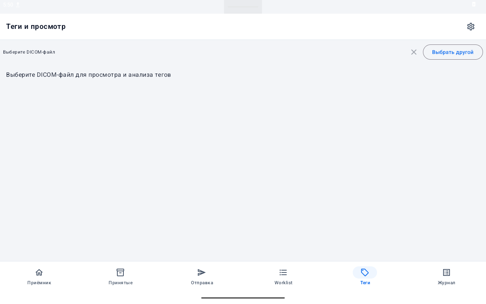
</p>

---

### 6. Диагностический технический журнал
Специализированная система аудита сетевого обмена для быстрого поиска причин сбоев:
- **Два режима отображения:**
  - **Краткий режим (сеансы):** агрегированные карточки сеансов (роль `SCP IN` / `SCU OUT`, удалённый узел `AE · IP:порт`, операция, число файлов, статус, время выполнения в мс). Персональные данные пациентов исключены для безопасного показа коллегам и заказчикам.
  - **Подробный режим:** пошаговый хронологический протокол всех событий сетевого уровня (`TCP_CONNECT`, `ASSOCIATE_RQ`, `ASSOCIATE_AC`, `PRESENTATION_CONTEXT`, `C_ECHO_RQ/RSP`, `C_STORE_RQ/RSP`, `RELEASE_RQ/RP`).
- **Неблокирующее асинхронное логирование:** события записываются в файл через выделенную фоновую очередь, предотвращая любые задержки сетевых потоков SCP и SCU.
- **Точная классификация ошибок:** детальная расшифровка отказов ассоциации `A-ASSOCIATE-RJ` (reason/source), отказов контекстов представления `A-ASSOCIATE-AC`, кодов статуса DIMSE (`0xBxxx Warning`, `0xCxxx / 0xAxxx Error`), разрывов `A-ABORT` и сетевых таймаутов.
- **Фильтрация и поиск:** выбор потоков (`Все`, `SCP IN`, `SCU OUT`), мгновенный поиск по IP, AE, UID или ошибке.
- **Экспорт журнала:** выгрузка полного журнала в структурированный файл `.tsv` для последующего анализа на ПК или передачи в техподдержку.

<p align="center">
  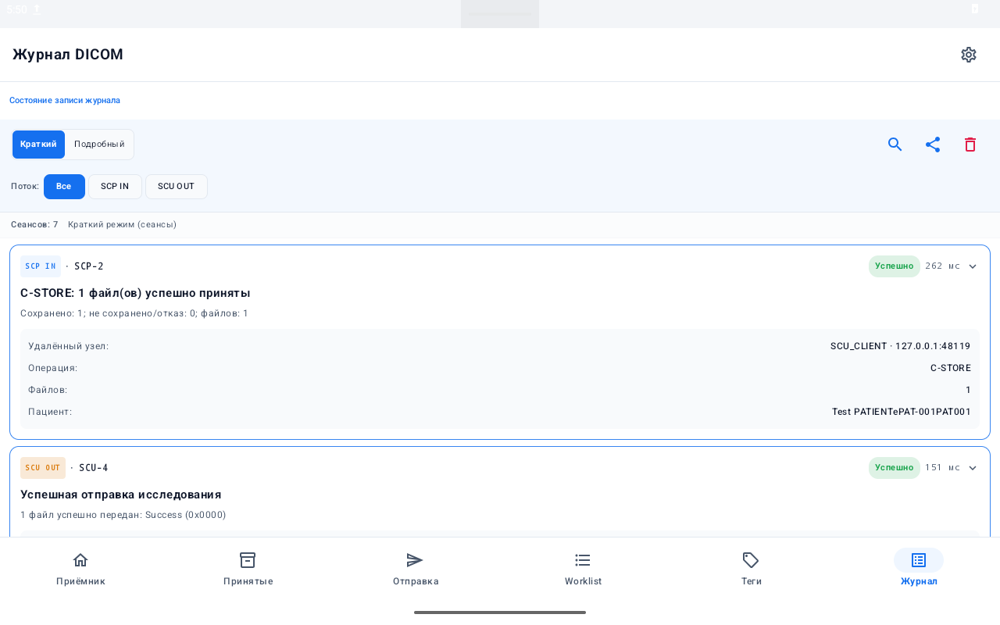
</p>

---

### 7. Modality Worklist (MWL SCP / SCU)
Полнофункциональная подсистема управления рабочими списками медицинских аппаратов по стандарту DICOM PS3.4 (SOP Class `Modality Worklist Information Model - FIND`, UID `1.2.840.10008.5.1.4.31`):

- **Сервер MWL SCP:** фоновая служба `MwlScpForegroundService`, отвечающая на запросы `C-FIND` от рентгеновских аппаратов, УЗИ и другого диагностического оборудования.
  - Поддержка непрерывных интервалов дат и времени назначения (PS3.4 K.6);
  - Настраиваемый AE Title, отдельный порт (по умолчанию `11112`), белый список сетевых клиентов;
  - Выбор кодировки выдачи Specific Character Set (`UTF-8 / ISO_IR 192` или `Cyrillic / ISO_IR 144`).

<p align="center">
  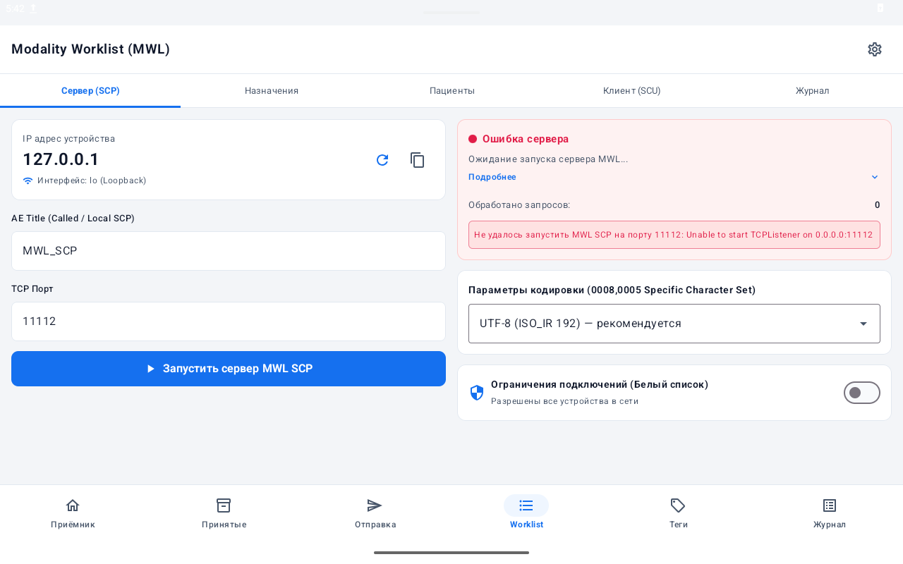
</p>

- **Назначения MWL:** оперативный список запланированных процедур:
  - Фильтры по модальности (`CR`, `DX`, `CT`, `MR`, `MG`, `US`, `Все`) и по датам;
  - Карточки процедур с отображением статуса, времени, кабинета, параметров оборудования;
  - Быстрое дублирование назначений и безопасное удаление.

<p align="center">
  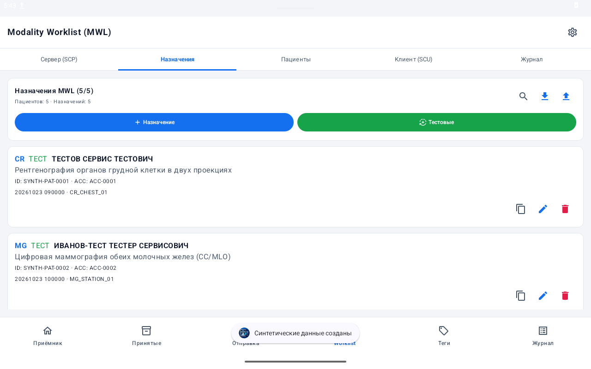
</p>

- **Пациенты MWL:** реестр пациентов с поддержкой DICOM PN:
  - Раздельный ввод Фамилии, Имени и Отчества с автоматической сборкой в стандартный DICOM PN (`ФАМИЛИЯ^ИМЯ^ОТЧЕСТВО`);
  - Пол пациента (`M`, `F`, `O`, не указан), дата рождения с удобным календарём;
  - Быстрое создание назначения конкретному пациенту по кнопке «Назначить»;
  - Безопасное каскадное удаление пациента с подсчётом связанных назначений и предупреждением.

<p align="center">
  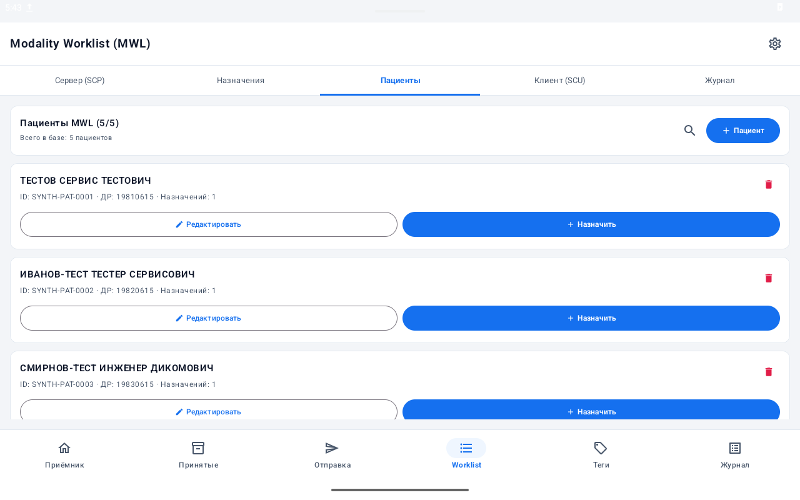
</p>

- **Форма «Новое назначение» и генерация идентификаторов:**
  - Чистое начальное состояние без навязанных демонстрационных значений;
  - Кнопка **«Сгенерировать ID»**: генерация `Accession Number` (`ACC-...`), `Requested Procedure ID` (`RP-...`) и `Scheduled Procedure Step ID` (`SPS-...`) в строгом соответствии с DICOM VR SH (до 16 символов);
  - Кнопка **«Сгенерировать UID»**: создание валидного `Study Instance UID` (VR UI, до 64 символов);
  - Защита от случайной перезаписи данных через диалог («Только пустые», «Перезаписать все», «Отмена»);
  - Выпадающий список типовых подсказок процедуры по модальности (Рентген, КТ, МРТ, Маммография, УЗИ и др.) с сохранением свободного ручного ввода;
  - Выбор профиля оборудования из сохранённых (`scheduledStationAeTitle`, `scheduledStationName`).

- **Клиент MWL SCU:** инструмент инженера для отправки запросов C-FIND на удалённые RIS/PACS и проверки возвращаемых рабочих списков, просмотра вложенных последовательностей (Sequences) и атрибутов.

<p align="center">
  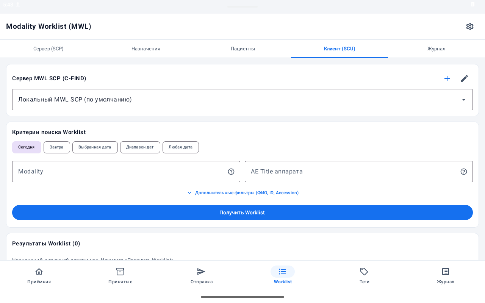
</p>

---

## Работа с кодировками символов и кириллицей

DICOM Kit спроектирован с учётом специфики работы с кириллицей в российских медицинских информационных системах:
- **Поддерживаемые кодировки (0008,0005):** `ISO_IR 192` (UTF-8), `ISO_IR 144` (ISO 8859-5 Cyrillic), `ISO_IR 100` (ISO 8859-1 Latin 1), `Windows-1251`.
- **Person Name (PN):** полноценная поддержка всех 5 компонентов (`Фамилия^Имя^Отчество^Префикс^Суффикс`) и до 3 групп представления (`Single-Byte = Ideographic = Phonetic`).
- **Синтетический генератор:** создаёт корректные кириллические имена пациентов без порчи байтов при сериализации.
- **Автоопределение:** эвристическое определение фактической кодировки при чтении некорректно оформленных файлов сторонних производителей с предупреждением в журнале.

---

## Требования Android и особенности фоновой работы

- **Минимальная версия:** Android 8.0 Oreo (API 26).
- **Рекомендуемая версия:** Android 13, 14, 15 (API 33–35).
- **Фоновые службы:** Storage SCP и MWL SCP работают как нативные Android Foreground Services с постоянным закреплённым уведомлением в шторке.
- **Рекомендации по энергосбережению OEM:**
  - На устройствах Samsung (One UI) и Xiaomi (MIUI / HyperOS) для бесперебойной многочасовой работы серверов при выключенном экране рекомендуется в системных настройках приложения установить режим аккумулятора в положение **«Без ограничений»** («Не экономить заряд»).
  - Для работы по Wi-Fi убедитесь, что в настройках сети отключено автоматическое отключение Wi-Fi в режиме ожидания.

---

## Установка и обновление без потери данных

### Установка Release APK
1. Загрузите подписанный файл [`DICOM-Kit-1.6.0-beta.1-release.apk`](builds/DICOM-Kit-1.6.0-beta.1-release.apk) из раздела [Releases](https://github.com/Eskimossss/dicom-kit/releases).
2. Разрешите установку из внешних источников в настройках Android.
3. Установите APK на устройство.

### Обновление поверх существующих версий
- **100% совместимость подписи:** сборка `1.6.0-beta.1` подписана тем же официальным релизным сертификатом (SHA-256 `4690b671b00bdda65c9740a27dbd2250dc8ccbdd95797e112c3c4763aa6c1a8d`), что и версии v1.3.1 и v1.5.0-alpha.x.
- Устанавливайте APK поверх установленной версии **без предварительного удаления**. Все ранее принятые DICOM-исследования, настройки PACS, база пациентов и назначений MWL сохраняются автоматически.

### Чистое начальное состояние
- При установке «начисто» база MWL не содержит искусственно предзаполненных пациентов.
- Для проверки функционала воспользуйтесь кнопкой **«Тестовые»** во вкладке «Назначения», которая сгенерирует набор демонстрационных пациентов и назначений для различных типов оборудования (Рентген, УЗИ, МРТ и др.).

---

## Известные ограничения beta-версии

1. **Статус Pre-release (Beta):** версия предназначена для проверки инженерами и тестирования совместимости в госпитальных сетях. Релиз не является финальным стабильным выпуском (General Availability).
2. **Планшетный интерфейс:** экраны оптимизированы для смартфонов от 360 dp и планшетов (включая Xiaomi Pad 6, 1280×800+ dp). На экранах с нестандартным вырезом фронтальной камеры в ландшафтной ориентации может потребоваться адаптация полей системных отступов.
3. **Одновременная работа Storage SCP и MWL SCP:** при одновременном запуске обоих серверов на одном устройстве необходимо назначать им **разные TCP-порты** (например, `11112` для Storage SCP и `11114` для MWL SCP).

---

## Сборка проекта из исходного кода

### Требования к окружению:
- **JDK:** OpenJDK 17 или 21.
- **Android SDK:** Platform 35, Build-Tools 36.0.0 (или 34.0.0+).
- **Gradle:** версия 8.10+ (включена через `gradlew wrapper`).

### Сборка Debug APK:
```powershell
# Windows PowerShell
$env:JAVA_HOME = "C:\Program Files\Android\openjdk\jdk-21.0.8"
.\gradlew.bat assembleDebug
```

### Запуск тестов:
```powershell
# Запуск модульных тестов JVM (349+ тестов)
.\gradlew.bat testDebugUnitTest

# Запуск инструментальных тестов на подключённом эмуляторе/устройстве
.\gradlew.bat connectedDebugAndroidTest -Pstage51Isolated=true
```

---

## Безопасность и защита персональных данных (PHI)

Приложение DICOM Kit спроектировано в строгом соответствии с требованиями к защите врачебной тайны и конфиденциальности данных:
1. **Отсутствие внешних сетевых вызовов:** приложение не содержит вызовов к сторонним веб-сервисам, облачным аналитическим платформам (Google Analytics, Firebase, AppMetrica и т.д.) или рекламным сетям.
2. **Локальное хранение:** вся база исследований хранится исключительно в приватном каталоге приложения (`getFilesDir()`) и недоступна другим приложениям без Root-прав.
3. **Безопасный экспорт:** журнал сетевого обмена в кратком виде очищен от клинических идентификаторов.
4. **Открытый аудит:** исходный код проекта открыт для независимого аудита безопасности медицинскими организациями.

---

## Лицензия

Собственный исходный код проекта **DICOM Kit** (пакет `ru.medeng.dicomtool`) лицензирован на условиях **[MIT License](LICENSE)**:

```text
Copyright (c) 2026 Eskimossss
```

### Сторонние компоненты и библиотеки
- **dcm4che** (`dcm4che-core`, `dcm4che-net`, `dcm4che-dict`): мульти-лицензия MPL 1.1 / LGPL 2.1 / GPL 2.0. В проекте DICOM Kit используется на условиях **Mozilla Public License Version 1.1 (MPL 1.1)**, допускающей создание комбинированных произведений (Larger Works) без изменения лицензии собственного кода приложения. Исходный код dcm4che доступен на [GitHub](https://github.com/dcm4che/dcm4che).
- **Google AndroidX & Jetpack Compose**: лицензия **Apache License 2.0**.
- **Kotlin & Coroutines** (JetBrains): лицензия **Apache License 2.0**.
- **SLF4J**: лицензия **MIT License**.

Подробный перечень сторонних библиотек, тексты лицензий и ссылки на репозитории приведены в файле [`THIRD_PARTY_NOTICES.md`](THIRD_PARTY_NOTICES.md).
